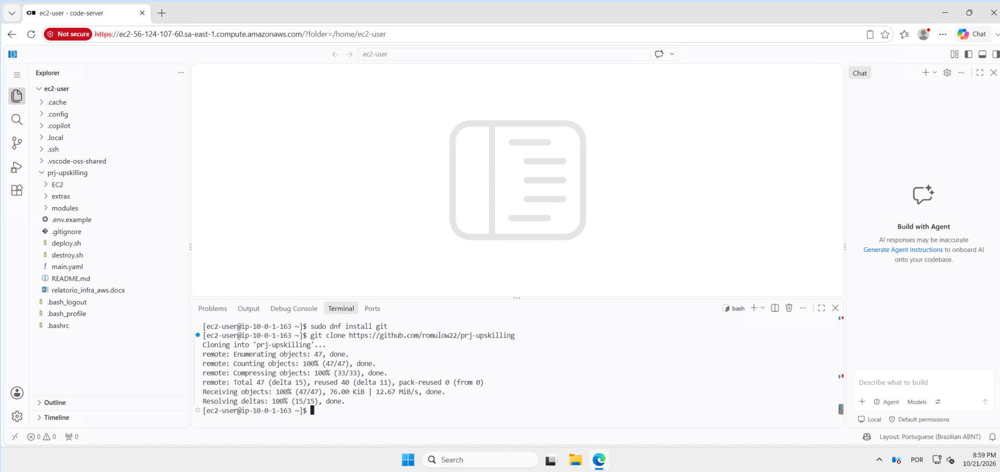
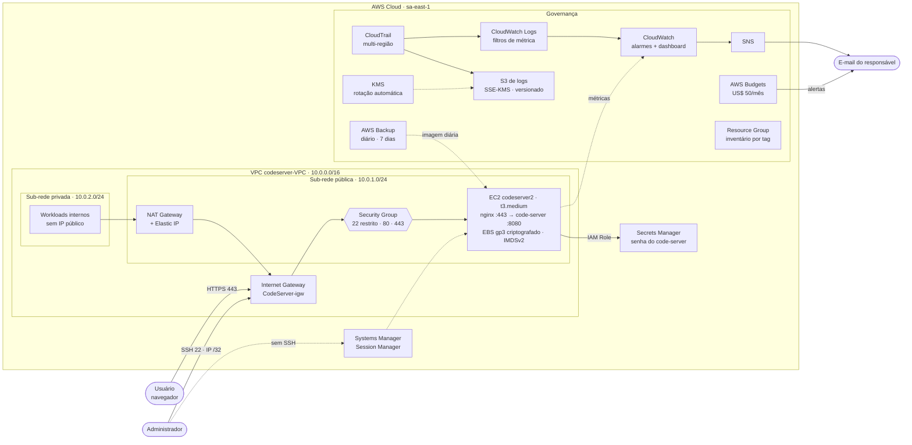
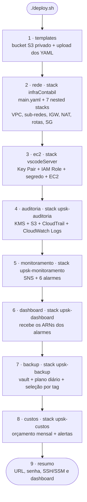
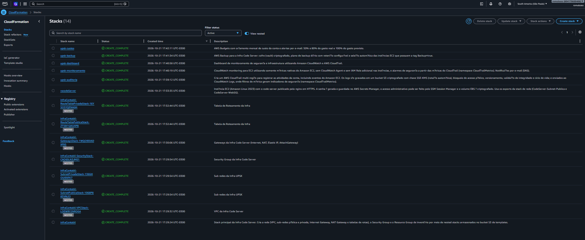
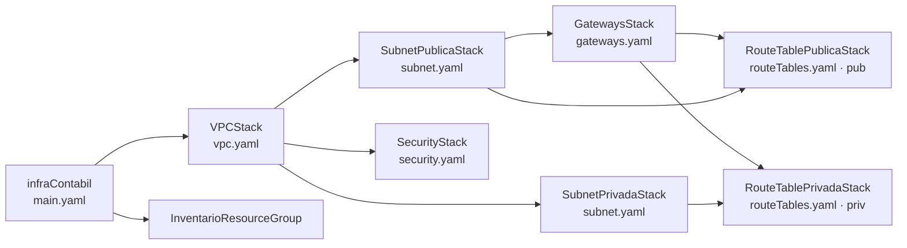
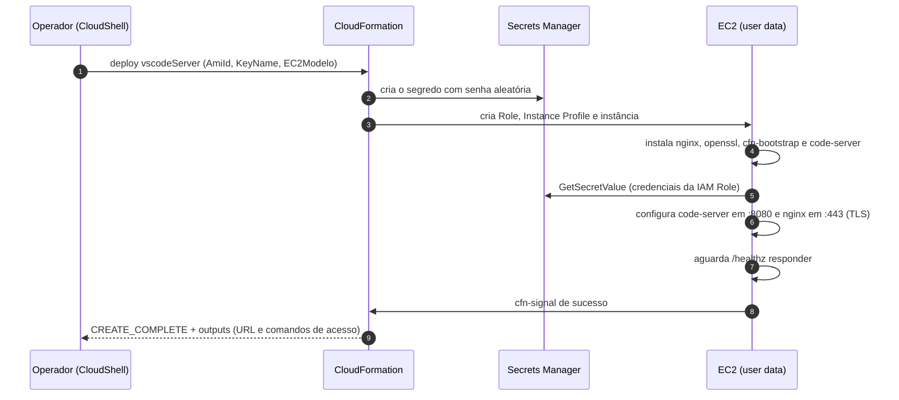
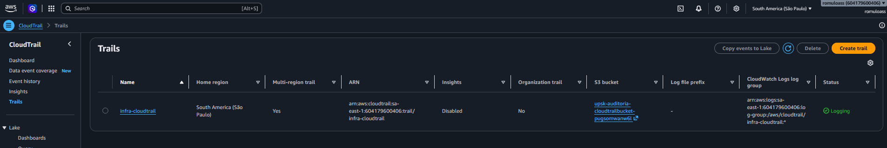
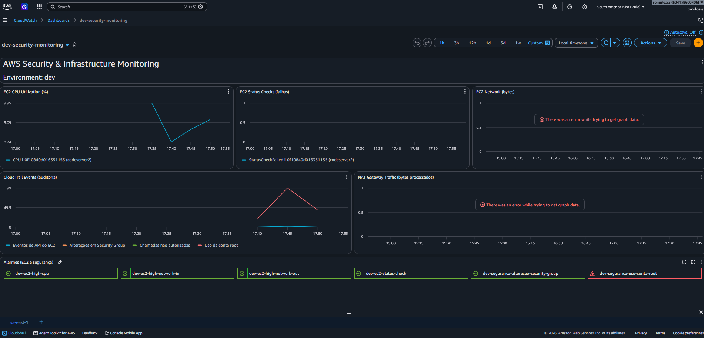
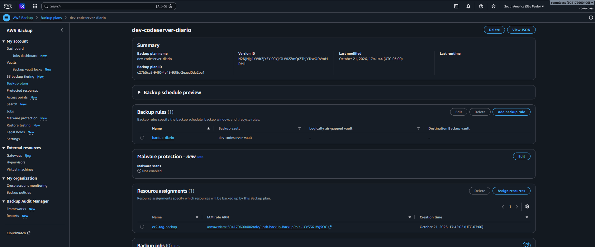
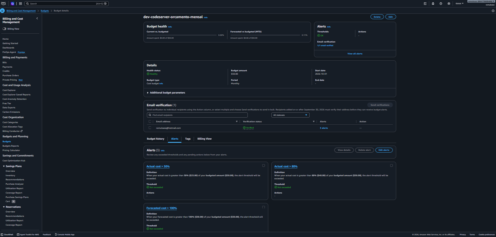

# Infraestrutura Cloud AWS — projeto-upskilling

Relatório do projeto final do curso de **Infraestrutura Cloud AWS**, preenchido a partir do modelo [relatorio_infra_aws.docx](relatorio_infra_aws_preenchido.docx).

| Projeto | Data | Região AWS | Repositório |
|---|---|---|---|
| Infra Code Server — VS Code no navegador na AWS | 20/10/2026 | `sa-east-1` (São Paulo) | [github.com/romulow22/prj-upskilling](https://github.com/romulow22/prj-upskilling) |

**Equipe:**

| Matrícula | Nome |
|---|---|
| c153824 | Romulo Alves |
| c161210 | Gustavo Coelho |
| c160795 | Marcos Andre |
| c155904 | Rocilda Pacifico |

**Apresentação:** [romulow22.github.io/prj-upskilling](https://romulow22.github.io/prj-upskilling/) — slides em HTML publicados pelo GitHub Pages ([como publicar](#apresentação-em-slides-github-pages)).

**Sumário:**
[1. Resumo](#1-resumo-do-projeto) ·
[2. Inventário](#2-inventário-de-recursos) ·
[3. Arquitetura](#3-arquitetura) ·
[Fluxo de implantação](#fluxo-de-implantação) ·
[Como implantar](#como-implantar) ·
[4. Segurança](#4-segurança-e-governança) ·
[5. Auditoria](#5-auditoria-e-monitoramento) ·
[6. Backup](#6-backup-e-recuperação) ·
[7. Custos](#7-custos-e-operação) ·
[8. Riscos](#8-pendências-e-riscos) ·
[9. Checklist](#9-checklist-de-entrega)

---

## 1. Resumo do projeto

O projeto entrega um **ambiente de desenvolvimento na nuvem**: o [code-server](https://github.com/coder/code-server) (VS Code acessado pelo navegador) em uma instância EC2. A infraestrutura é criada **100% como código** com AWS CloudFormation e executada por um único script, o [deploy.sh](deploy.sh).

A solução tem três camadas:

- **Rede:** VPC própria com sub-rede pública e privada, Internet Gateway, NAT Gateway, tabelas de rotas e Security Group. Os módulos são *nested stacks* reutilizáveis.
- **Computação:** EC2 Amazon Linux 2023 com o code-server atrás do nginx em HTTPS. A senha fica no AWS Secrets Manager e o disco EBS é criptografado. O acesso administrativo pode ser feito pelo SSM Session Manager.
- **Governança:**
  - Auditoria com CloudTrail, que grava os logs no S3 com KMS e no CloudWatch Logs.
  - Monitoramento com alarmes do CloudWatch, notificação por SNS e dashboard.
  - Backup diário com AWS Backup.
  - Controle de custos com AWS Budgets.
  - Inventário com tags e Resource Group.

**Ambiente em execução:** o code-server aberto no navegador, servido pela EC2 em `sa-east-1`, com este repositório clonado no terminal integrado. O aviso *Not secure* vem do certificado autoassinado ([seção 8](#8-pendências-e-riscos)).



---

## 2. Inventário de recursos

Os IDs físicos (`vpc-…`, `i-…`, `sg-…`) são gerados na implantação. Para listar todos os recursos do projeto, use o Resource Group de inventário:

```bash
aws resource-groups list-group-resources --group projeto-upskilling-inventario --region sa-east-1
```

| Recurso | ID / Nome | Finalidade / Configuração |
|---|---|---|
| VPC | `codeserver-VPC` (export `UPSK-VPC`) | `10.0.0.0/16`, DNS support e DNS hostnames habilitados |
| Sub-rede pública | `Subnet-Publica` (export `CodeServer-Subnet-Publica`) | `10.0.1.0/24`, 1ª AZ, IP público automático. Hospeda a EC2 e o NAT Gateway |
| Sub-rede privada | `Subnet-Privada` (export `CodeServer-Subnet-Privada`) | `10.0.2.0/24`, 1ª AZ, sem IP público. Saída para a internet pelo NAT |
| Internet Gateway | `CodeServer-igw` | Entrada e saída de internet da sub-rede pública |
| Elastic IP | `CodeServer-nat-eip` | IP público fixo do NAT Gateway |
| NAT Gateway | `NAT Gateway` | Saída de internet da sub-rede privada (sem conexões de entrada) |
| Route table pública | `pub-route-table` | `0.0.0.0/0` → Internet Gateway |
| Route table privada | `priv-route-table` | `0.0.0.0/0` → NAT Gateway |
| Security Group | `Firewall-CodeServer` (export `CodeServer-WebSG`) | Portas 22 (só o IP do administrador), 80 (redireciona para HTTPS) e 443 (code-server) |
| EC2 | `codeserver2` | `t3.medium`, Amazon Linux 2023, gp3 20 GiB criptografado, IMDSv2 obrigatório, créditos de CPU *standard*, tag `Backup=true` |
| IAM Role + Instance Profile da EC2 | `vscodeServer-CodeServerRole-*` | `AmazonSSMManagedInstanceCore` + leitura apenas do segredo do code-server |
| Segredo | `CodeServerSecret-*` (Secrets Manager) | Senha aleatória de 20 caracteres do code-server |
| Key Pair | `code-server` | RSA. Chave privada salva apenas em `~/code-server.pem` (permissão 400) |
| Chave KMS | `alias/infra-cloudtrail-logs` | Criptografa os logs do CloudTrail. Rotação automática. Retida ao excluir a stack |
| Bucket S3 de logs | `upsk-auditoria-cloudtrailbucket-*` | SSE-KMS, bloqueio de acesso público, versionamento, ciclo de vida de 365 dias e somente TLS. Retido ao excluir a stack |
| CloudTrail | `infra-cloudtrail` | Multi-região, eventos globais e validação de integridade dos logs |
| Log group | `/aws/cloudtrail/infra-cloudtrail` | Retenção de 30 dias e 4 filtros de métrica (namespace `CloudTrailMetrics`) |
| IAM Role do CloudTrail | `upsk-auditoria-CloudTrailLogsRole-*` | Grava os eventos no CloudWatch Logs |
| Tópico SNS | `dev-ec2-alerts` | Envia os alarmes por e-mail |
| Alarmes do CloudWatch | `dev-ec2-*` e `dev-seguranca-*` | 4 alarmes de EC2 e 2 de segurança (ver [seção 5](#5-auditoria-e-monitoramento)) |
| Dashboard | `dev-security-monitoring` | Painéis de EC2, NAT, CloudTrail e status dos alarmes |
| Backup Vault | `dev-codeserver-vault` | Cofre criptografado com a chave `aws/backup` |
| Backup Plan / Selection | `dev-codeserver-diario` / `ec2-tag-backup` | Backup diário às 03:00 (America/Sao_Paulo), retenção de 7 dias, apenas EC2 com `Backup=true` |
| IAM Role do Backup | `upsk-backup-BackupRole-*` | Políticas gerenciadas de backup e restauração |
| Budget | `dev-codeserver-orcamento-mensal` | US$ 50/mês. Alertas em 50% e 80% do gasto real e em 100% do previsto |
| Resource Group | `projeto-upskilling-inventario` | Agrupa todos os recursos com a tag `Projeto=projeto-upskilling` |
| Bucket S3 de templates | `contabil-11111992` | Guarda os templates do CloudFormation. Quando criado pelo script: privado, SSE-S3 e versionado |

---

## 3. Arquitetura

O usuário acessa o code-server por **HTTPS (443)**. O tráfego entra pelo Internet Gateway, passa pelo Security Group e chega ao **nginx** da EC2. O nginx encerra o TLS e repassa as conexões, incluindo WebSocket, ao code-server em `127.0.0.1:8080`. A porta 8080 não é exposta na rede. Requisições HTTP (80) recebem redirecionamento para HTTPS.

A EC2 não usa chaves de acesso. Ela assume uma **IAM Role** e, com ela, lê a senha no **Secrets Manager** durante o bootstrap. A mesma role permite o acesso administrativo pelo **SSM Session Manager**, sem SSH. A sub-rede privada não recebe conexões da internet: sua saída passa pelo **NAT Gateway**. Ela fica disponível para workloads internos, como banco de dados ou APIs.

Toda chamada de API na conta é registrada pelo **CloudTrail**. Os eventos vão para o S3 (criptografado com KMS) e para o **CloudWatch Logs**. No CloudWatch Logs, filtros de métrica geram indicadores de segurança. Os **alarmes** usam esses indicadores e as métricas nativas da EC2 e notificam por e-mail via **SNS**. O **AWS Backup** cria uma imagem diária da EC2. O **AWS Budgets** acompanha o gasto da conta.



| Origem | Destino | Protocolo / porta | Observação |
|---|---|---|---|
| Internet | nginx (EC2) | HTTPS 443 | Certificado TLS autoassinado |
| Internet | nginx (EC2) | HTTP 80 | Redirecionamento 301 para HTTPS |
| IP do administrador (`/32`) | EC2 | SSH 22 | IP detectado pelo `deploy.sh` ou definido em `SSH_CIDR` |
| nginx | code-server | HTTP 8080 (localhost) | Inclui WebSocket. Não exposto na rede |
| EC2 | Secrets Manager / SSM | HTTPS 443 | Credenciais temporárias da IAM Role |
| Sub-rede privada | Internet | Via NAT Gateway | Apenas saída |
| CloudTrail | S3 / CloudWatch Logs | Serviço AWS | Logs criptografados com KMS no S3 |

---

## Fluxo de implantação

### Visão geral (o que o `deploy.sh` executa)

O [deploy.sh](deploy.sh) executa **9 etapas** em ordem. Cada etapa é uma stack do CloudFormation, exceto `templates` e `resumo`. As etapas podem ser executadas separadamente, o que permite uma demonstração passo a passo.



| # | Etapa | Stack | Template | O que é criado | Depende de | Tempo aprox. |
|---|---|---|---|---|---|---|
| 1 | `templates` | — | todos | Bucket privado e upload dos templates para o S3 | — | < 1 min |
| 2 | `rede` | `infraContabil` | [main.yaml](main.yaml) + [modules/](modules) | VPC, 2 sub-redes, IGW, EIP, NAT, 2 route tables, SG, Resource Group | 1 | 3–5 min |
| 3 | `ec2` | `vscodeServer` | [EC2/codeserver.yaml](EC2/codeserver.yaml) | Key Pair, segredo, IAM Role, Instance Profile, EC2 com bootstrap | 2 (exports) | 5–8 min |
| 4 | `auditoria` | `upsk-auditoria` | [extras/auditoria-cloudtrail.yaml](extras/auditoria-cloudtrail.yaml) | KMS, S3 de logs, CloudTrail, log group, role, 4 filtros de métrica | — | 1–2 min |
| 5 | `monitoramento` | `upsk-monitoramento` | [extras/monitoramento-cloudwatch.yaml](extras/monitoramento-cloudwatch.yaml) | SNS + assinatura por e-mail, 6 alarmes | 4 (métricas de segurança) | ~1 min |
| 6 | `dashboard` | `upsk-dashboard` | [extras/dashboard.yaml](extras/dashboard.yaml) | Dashboard `dev-security-monitoring` | 5 (ARNs dos alarmes) | < 1 min |
| 7 | `backup` | `upsk-backup` | [extras/backup.yaml](extras/backup.yaml) | Vault, plano, seleção, IAM Role | 3 (tag `Backup=true`) | ~1 min |
| 8 | `custos` | `upsk-custos` | [extras/custos-budget.yaml](extras/custos-budget.yaml) | Budget com 3 alertas | — | < 1 min |
| 9 | `resumo` | — | — | Exibe os outputs de acesso | 3, 6 | — |

**Resultado no console (`sa-east-1`):** as 7 stacks do `deploy.sh` e as 7 nested stacks da rede em `CREATE_COMPLETE`.



### Dentro da etapa 2: ordem dos nested stacks

O CloudFormation resolve a ordem pelas dependências (`!GetAtt`) entre os módulos de [modules/](modules):



### Dentro da etapa 3: bootstrap da EC2

A stack só termina com sucesso quando o code-server responde. Isso é garantido pela `CreationPolicy` e pelo `cfn-signal`:



### Roteiro sugerido para a apresentação

| Passo | O que mostrar | Onde |
|---|---|---|
| 1 | Problema e solução: VS Code no navegador com segurança e governança | Seção 1 e diagrama da seção 3 |
| 2 | Infraestrutura como código: estrutura do repositório e módulos | [Estrutura do repositório](#estrutura-do-repositório) |
| 3 | Execução do `./deploy.sh` (ou stacks já criadas) e a árvore de nested stacks | Console CloudFormation |
| 4 | Acesso ao code-server: URL do output e senha lida do Secrets Manager | Navegador + `ComandoSenha` |
| 5 | Segurança: regras do SG, IMDSv2, EBS criptografado e sessão via SSM sem SSH | Consoles EC2 e Systems Manager |
| 6 | Auditoria ao vivo: alterar uma regra do SG → evento no CloudTrail → alarme → e-mail | CloudTrail, dashboard e e-mail |
| 7 | Backup: job sob demanda e ponto de recuperação no vault | Console AWS Backup |
| 8 | Custos e inventário: Budget, tags e Resource Group | Billing e Resource Groups |
| 9 | Encerramento: riscos, próximos passos e `./destroy.sh` | Seções 8 e 7 |

### Apresentação em slides (GitHub Pages)

O [index.html](index.html) é uma apresentação curta, com 10 slides que seguem o roteiro acima. É um arquivo único, sem dependências externas, que usa as capturas de [images/](images). Para publicá-la:

1. No GitHub, abra *Settings → Pages*.
2. Em *Build and deployment*, escolha *Deploy from a branch*, a branch `main` e a pasta `/ (root)`.
3. Depois do build, a apresentação fica em `https://romulow22.github.io/prj-upskilling/`.

O arquivo [.nojekyll](.nojekyll) faz o Pages publicar os arquivos como estão, sem processá-los com o Jekyll. Na apresentação, use as setas ou deslize para navegar. `F` ativa a tela cheia, e um clique em uma captura a amplia. Cada slide tem endereço próprio (`#1` a `#10`), e *Imprimir → Salvar como PDF* gera uma página por slide.

---

## Como implantar

### Pré-requisitos

- AWS CLI v2 com credenciais válidas. Use o [AWS CloudShell](https://console.aws.amazon.com/cloudshell), um profile já configurado ou o arquivo `.env` de um usuário de serviço ([veja abaixo](#execução-de-qualquer-máquina-usuário-de-serviço)).
- Permissão para criar recursos de CloudFormation, EC2/VPC, IAM, S3, KMS, CloudTrail, CloudWatch/Logs, SNS, Secrets Manager, Systems Manager, AWS Backup, AWS Budgets e Resource Groups.
- Um e-mail para receber os alertas.

> **Atenção:** se as stacks `infraContabil` e `vscodeServer` já existirem com a versão anterior dos templates, execute `./destroy.sh` antes. Os arquivos [main.yaml](main.yaml) e [EC2/codeserver.yaml](EC2/codeserver.yaml) foram reconstruídos, e os nomes de exports e sub-redes podem ser diferentes dos anteriores.

> **Ambiente anterior em `us-east-1`:** a região padrão agora é `sa-east-1` (São Paulo). Se o ambiente já foi implantado em `us-east-1`, remova-o antes com `REGION=us-east-1 ./destroy.sh`. Os nomes do Budget e do trail multirregião valem para a conta inteira e causariam conflito. O bucket de templates é mantido pelo `destroy.sh` e continua em `us-east-1`. Como o nome de bucket é global, o `deploy.sh` para com erro se encontrar o bucket em outra região. Nesse caso, use outro nome (`BUCKET=meu-bucket-sa ./deploy.sh`) ou exclua o bucket antigo.

### Execução

```bash
git clone https://github.com/romulow22/prj-upskilling.git
cd prj-upskilling

# Todas as etapas
EMAIL=seu.email@exemplo.com ./deploy.sh

# Ou etapa por etapa (útil na apresentação)
./deploy.sh templates rede
./deploy.sh ec2
./deploy.sh auditoria
EMAIL=seu.email@exemplo.com ./deploy.sh monitoramento dashboard
./deploy.sh backup
EMAIL=seu.email@exemplo.com ./deploy.sh custos resumo
```

| Variável | Padrão | Uso |
|---|---|---|
| `EMAIL` | — (obrigatória em `monitoramento` e `custos`) | Destino dos alarmes e alertas de custo |
| `REGION` | `sa-east-1` | Região da implantação |
| `BUCKET` | `contabil-11111992` | Bucket dos templates. É criado se não existir e precisa estar na mesma região do deploy |
| `SSH_CIDR` | IP público detectado + `/32` | Origem autorizada na porta 22 |
| `EC2_MODELO` | `t3.medium` | `t3.micro`, `t3.small`, `t3.medium` ou `t3.large` |
| `NOME_INSTANCIA` | `codeserver2` | Tag `Name` da EC2 |
| `ORCAMENTO_USD` | `50` | Valor do orçamento mensal |
| `PROJETO` / `AMBIENTE` / `RESPONSAVEL` | `projeto-upskilling` / `dev` / `c153824` | Tags propagadas para todos os recursos. `RESPONSAVEL` aceita um único valor: use a matrícula de quem executa o deploy |
| `ATUALIZAR_AMI` | `nao` | `sim` busca a AMI mais recente. Isso **substitui** a instância |
| `ENV_FILE` | `.env` na pasta dos scripts | Arquivo de configuração alternativo (credenciais e variáveis acima) |

### Execução de qualquer máquina (usuário de serviço)

Fora do CloudShell, o `deploy.sh` e o `destroy.sh` leem as credenciais e as variáveis do arquivo `.env` que fica na pasta dos scripts. O modelo é o [.env.example](.env.example). O arquivo é lido como texto (`CHAVE=valor`) e não é executado. Variáveis passadas na linha de comando têm prioridade sobre o arquivo.

1. Um administrador cria o usuário de serviço e a access key. Em conta de laboratório, `AdministratorAccess` atende. Em produção, use uma política restrita aos serviços dos pré-requisitos.

   ```bash
   aws iam create-user --user-name svc-upskilling-deploy --tags Key=Projeto,Value=projeto-upskilling
   aws iam attach-user-policy --user-name svc-upskilling-deploy \
     --policy-arn arn:aws:iam::aws:policy/AdministratorAccess
   aws iam create-access-key --user-name svc-upskilling-deploy \
     --query 'AccessKey.[AccessKeyId,SecretAccessKey]' --output text
   ```

2. Crie o `.env` a partir do modelo e preencha `AWS_ACCESS_KEY_ID`, `AWS_SECRET_ACCESS_KEY` e `EMAIL`:

   ```bash
   cp .env.example .env
   chmod 600 .env
   ```

3. Execute de qualquer diretório. Para guardar o arquivo fora do repositório, use `ENV_FILE`:

   ```bash
   /caminho/para/prj-upskilling/deploy.sh
   ENV_FILE=~/upskilling.env /caminho/para/prj-upskilling/deploy.sh ec2
   ```

4. Para os comandos `aws` manuais deste README, carregue o mesmo arquivo no shell: `set -a; . ./.env; set +a`.

> **Segurança:** o `.env` contém a secret access key e está no [.gitignore](.gitignore) (assim como `.env.*`, exceto o modelo). Nunca o versione. Ao terminar a apresentação, exclua a chave com `aws iam delete-access-key --user-name svc-upskilling-deploy --access-key-id <id>`.

### Depois do deploy

1. Confirme a assinatura do SNS no e-mail recebido. Sem isso, os alarmes não chegam.
2. Consulte a senha: execute o comando do output `ComandoSenha`, que também aparece no resumo.
3. Acesse a URL `CodeServerURL` e aceite o aviso do certificado autoassinado.

---

## 4. Segurança e governança

| Controle | Como foi implementado | Evidência |
|---|---|---|
| **Segmentação de rede** | VPC dedicada com sub-rede pública e privada. A privada não tem IP público nem rota de entrada, e sai pela internet só via NAT. Rotas separadas por tabela. Security Group libera apenas 22 (IP do administrador `/32`), 80 e 443. O code-server escuta só em `127.0.0.1:8080` | [modules/](modules), [main.yaml](main.yaml). Console VPC → *Security Groups* → `Firewall-CodeServer` e *Route tables* |
| **Controle de acesso / IAM** | Nenhuma chave de acesso na instância: a EC2 usa IAM Role com `AmazonSSMManagedInstanceCore` e `secretsmanager:GetSecretValue` restrito ao ARN do seu segredo (menor privilégio). Roles dedicadas ao CloudTrail e ao AWS Backup. Acesso administrativo pelo SSM Session Manager, sem depender de SSH | [EC2/codeserver.yaml](EC2/codeserver.yaml) (`CodeServerRole`). Console IAM → *Roles*. Sessões em Systems Manager → *Session Manager* → *History* |
| **Criptografia de dados** | Em repouso: EBS gp3 criptografado; logs do CloudTrail com SSE-KMS (chave própria com rotação automática); segredo e backups criptografados com KMS. Em trânsito: HTTPS com TLS 1.2/1.3 no nginx e bucket de logs que nega requisições sem TLS | `Encrypted: true` em [EC2/codeserver.yaml](EC2/codeserver.yaml). `CloudTrailKMSKey` e `DenyInsecureTransport` em [extras/auditoria-cloudtrail.yaml](extras/auditoria-cloudtrail.yaml) |
| **Proteção do S3** | Bucket de logs com *Block Public Access* (4 opções), SSE-KMS com Bucket Key, versionamento, política só para o CloudTrail da própria conta (`aws:SourceAccount`), negação de transporte inseguro, ciclo de vida de 365 dias e `DeletionPolicy: Retain`. Bucket de templates privado, com SSE-S3 e versionado | Console S3 → bucket → *Permissions* e *Properties*. `aws s3api get-public-access-block --bucket <bucket>` |
| **Tags e inventário** | Tags de stack propagadas pelo CloudFormation para todos os recursos: `Projeto`, `Ambiente`, `Responsavel`, `CentroCusto` e `GerenciadoPor`. Tags `Name` por recurso e `Backup=true` na EC2. Resource Group `projeto-upskilling-inventario` lista tudo o que tem `Projeto=projeto-upskilling` | `TAGS` em [deploy.sh](deploy.sh). Console Resource Groups & Tag Editor |
| **Gestão de segredos** | Senha do code-server gerada pelo Secrets Manager. Ela não aparece no código, nos parâmetros nem nos outputs, e é lida pela instância via IAM Role. A chave privada SSH é gravada com `umask 077`/`chmod 400` só na máquina do operador. As credenciais do usuário de serviço ficam no `.env` local (`chmod 600`), fora do Git. O [.gitignore](.gitignore) bloqueia `*.pem`, `*.key`, `.env` e `.env.*` | Console Secrets Manager. Output `ComandoSenha`. [.gitignore](.gitignore) |
| **Proteção da instância** | IMDSv2 obrigatório, AMI Amazon Linux 2023, versão do nginx oculta (`server_tokens off`) e créditos de CPU *standard* | `MetadataOptions` em [EC2/codeserver.yaml](EC2/codeserver.yaml) |

**Regras de rede revisadas (Security Group `Firewall-CodeServer`):**

| Direção | Porta | Origem/Destino | Finalidade |
|---|---|---|---|
| Entrada | 22/TCP | IP do administrador `/32` | SSH administrativo (alternativa: SSM, sem porta aberta) |
| Entrada | 80/TCP | `0.0.0.0/0` | Redirecionamento para HTTPS |
| Entrada | 443/TCP | `0.0.0.0/0` | code-server (protegido por senha) |
| Saída | Todas | `0.0.0.0/0` | Pacotes, instalador do code-server e APIs AWS |

**Permissões revisadas (IAM):**

| Role | Assumida por | Permissões |
|---|---|---|
| `CodeServerRole` | EC2 | `AmazonSSMManagedInstanceCore` + `secretsmanager:GetSecretValue` apenas no segredo do code-server |
| `CloudTrailLogsRole` | CloudTrail | `logs:CreateLogStream` e `logs:PutLogEvents` apenas no log group do trail |
| `BackupRole` | AWS Backup | `AWSBackupServiceRolePolicyForBackup` e `AWSBackupServiceRolePolicyForRestores` |

---

## 5. Auditoria e monitoramento

**Registro das atividades:** o trail `infra-cloudtrail` é multi-região, inclui eventos de serviços globais (como o IAM) e registra todos os eventos de gerenciamento (leitura e escrita). Os arquivos vão para o S3 com criptografia KMS e validação de integridade, para provar que não foram alterados. Os eventos também são enviados em tempo real ao CloudWatch Logs (`/aws/cloudtrail/infra-cloudtrail`, retenção de 30 dias).



*Trail `infra-cloudtrail`:* região de origem São Paulo, multirregião, logs no bucket `upsk-auditoria-cloudtrailbucket-*` e no log group `/aws/cloudtrail/infra-cloudtrail`, com status *Logging*.

**Logs monitorados (filtros de métrica, namespace `CloudTrailMetrics`):**

| Métrica | Filtro | Uso |
|---|---|---|
| `EventosEC2` | `eventSource = ec2.amazonaws.com` | Volume de chamadas de API do EC2 (dashboard) |
| `AlteracoesSecurityGroup` | Create, Delete, Authorize e Revoke de Security Group | Alarme e dashboard |
| `ChamadasNaoAutorizadas` | `errorCode` `*UnauthorizedOperation` ou `AccessDenied*` | Dashboard |
| `UsoContaRoot` | `userIdentity.type = Root` | Alarme e dashboard |

**Alarmes configurados (notificação por SNS → e-mail):**

| Alarme | Métrica | Condição |
|---|---|---|
| `dev-ec2-high-cpu` | `CPUUtilization` (Metrics Insights, maior valor entre as EC2) | ≥ 80% em 2 períodos de 5 min (avisa também a normalização) |
| `dev-ec2-status-check` | `StatusCheckFailed` | ≥ 1 em 2 períodos de 1 min (avisa também a normalização) |
| `dev-ec2-high-network-in` | `NetworkIn` | > 1 GiB em 2 de 3 períodos de 5 min |
| `dev-ec2-high-network-out` | `NetworkOut` | > 1 GiB em 2 de 3 períodos de 5 min |
| `dev-seguranca-alteracao-security-group` | `CloudTrailMetrics/AlteracoesSecurityGroup` | ≥ 1 em 5 min |
| `dev-seguranca-uso-conta-root` | `CloudTrailMetrics/UsoContaRoot` | ≥ 1 em 5 min |

**Dashboard `dev-security-monitoring`:** CPU, status checks e rede da EC2; tráfego do NAT Gateway; eventos de auditoria do CloudTrail; e o status de todos os alarmes. Os painéis de EC2 usam consultas *Metrics Insights*, que funcionam com o monitoramento básico (gratuito). A URL está no output `SecurityDashboardURL`.

> O alarme de alteração de Security Group dispara no próprio deploy da rede (`CreateSecurityGroup`). Esse é o comportamento esperado e serve de demonstração.



*Dashboard em execução:* os painéis de CPU, status checks e eventos do CloudTrail mostram dados, e o painel de status exibe os 6 alarmes. O alarme `dev-seguranca-uso-conta-root` está em **ALARM** porque houve atividade da conta root no período (linha *Uso da conta root* do painel de eventos). Na captura, feita antes da correção, os painéis *EC2 Network* e *NAT Gateway Traffic* mostravam erro porque cada um tinha duas consultas Metrics Insights, e o CloudWatch aceita só uma consulta por gráfico. No [extras/dashboard.yaml](extras/dashboard.yaml) atual, cada consulta tem painel próprio: *EC2 Network In*, *EC2 Network Out*, *NAT Gateway - saída* e *NAT Gateway - retorno*. Para aplicar a correção em um ambiente já implantado, execute `./deploy.sh dashboard`.

**Evidências** (as pendentes devem ser coletadas no ambiente em execução):

- [x] CloudTrail → *Trails* → `infra-cloudtrail` (status *Logging*, multirregião) — [captura](images/cloudtrail_trails.png).
- [ ] CloudTrail → *Event history* filtrado por `AuthorizeSecurityGroupIngress`.
- [ ] Integridade dos logs: `aws cloudtrail validate-logs --trail-arn <arn> --start-time <data>`.
- [ ] CloudWatch → *Log groups* → `/aws/cloudtrail/infra-cloudtrail` → *Metric filters*.
- [ ] CloudWatch → *Alarms* (6 alarmes) e e-mail de alarme recebido. O status dos 6 alarmes já aparece no dashboard.
- [x] CloudWatch → *Dashboards* → `dev-security-monitoring` — [captura](images/dev-security-monitoring-dashboard.png).

---

## 6. Backup e recuperação

**Estratégia:**

| Item | Definição |
|---|---|
| Ferramenta | AWS Backup ([extras/backup.yaml](extras/backup.yaml)) |
| Escopo | Instâncias EC2 com a tag `Backup=true`: imagem (AMI) com snapshot do volume EBS |
| Frequência | Diária às 03:00 (`America/Sao_Paulo`), janela de início de 60 min e conclusão em até 180 min |
| Retenção | 7 dias (parâmetro `RetencaoDias`) |
| Armazenamento | Vault `dev-codeserver-vault`, criptografado. O snapshot herda a criptografia do EBS |
| RPO / RTO estimados | RPO de 24 h / RTO de ~15–30 min (restauração da AMI + boot) |
| Infraestrutura | Recriada pelo código (`./deploy.sh`) a partir do repositório Git e do bucket de templates versionado |
| Logs de auditoria | Versionados, retidos por 365 dias e preservados mesmo após excluir a stack |



*Plano `dev-codeserver-diario`:* regra `backup-diario` no vault `dev-codeserver-vault` e atribuição `ec2-tag-backup` com a role `upsk-backup-BackupRole-*`. Na captura, o plano tinha acabado de ser criado e ainda não havia execuções (*Last runtime* vazio e 0 jobs). A primeira janela é às 03:00.

**Procedimento de teste de restauração:**

```bash
# 1. Backup sob demanda da EC2
export AWS_REGION=sa-east-1
INSTANCIA=$(aws cloudformation describe-stacks --stack-name vscodeServer \
  --query "Stacks[0].Outputs[?OutputKey=='InstanceId'].OutputValue" --output text)
ROLE=$(aws cloudformation describe-stacks --stack-name upsk-backup \
  --query "Stacks[0].Outputs[?OutputKey=='BackupRoleArn'].OutputValue" --output text)
CONTA=$(aws sts get-caller-identity --query Account --output text)

aws backup start-backup-job --backup-vault-name dev-codeserver-vault \
  --resource-arn "arn:aws:ec2:${AWS_REGION}:${CONTA}:instance/${INSTANCIA}" \
  --iam-role-arn "${ROLE}"

# 2. Acompanhar até COMPLETED
aws backup list-backup-jobs --by-backup-vault-name dev-codeserver-vault \
  --query 'BackupJobs[].[State,RecoveryPointArn]' --output table
```

3. No console **AWS Backup → Backup vaults → `dev-codeserver-vault`**, selecione o ponto de recuperação e clique em **Restore**. Escolha a sub-rede `Subnet-Publica`, o SG `Firewall-CodeServer` e a role de restauração `upsk-backup-BackupRole-*`.
4. Valide o acesso `https://<IP da instância restaurada>` com a mesma senha e confira os arquivos do workspace.
5. Encerre a instância restaurada para evitar custo.

**Resultado do teste de restauração** (registrar após a execução):

| Data | Ponto de recuperação | Tempo de restauração | Resultado | Responsável |
|---|---|---|---|---|
| ___/___/____ | `ami-…` | ___ min | ☐ Sucesso ☐ Falha | __________ |

---

## 7. Custos e operação

**Estimativa de referência** (sa-east-1 — São Paulo, sob demanda, 730 h/mês, ambiente ligado 24x7). Os valores são aproximados; valide no [AWS Pricing Calculator](https://calculator.aws/).

| Item | Base de cálculo | US$/mês |
|---|---|---|
| NAT Gateway | US$ 0,093/h + US$ 0,093/GB processado | ~67,89 + tráfego |
| EC2 `t3.medium` | US$ 0,0672/h | ~49,06 |
| IPv4 públicos (EC2 + EIP do NAT) | 2 × US$ 0,005/h | ~7,30 |
| EBS gp3 20 GiB | US$ 0,152/GB-mês | ~3,04 |
| CloudWatch: 6 alarmes + 4 métricas de filtros + logs | ~US$ 0,135/alarme, US$ 0,30/métrica, US$ 0,90/GB ingerido | ~2,40 |
| KMS (1 chave) + Secrets Manager (1 segredo) | US$ 1,00 + US$ 0,40 | ~1,40 |
| AWS Backup (snapshots incrementais, 7 dias) | US$ 0,068/GB-mês | ≤ 1,40 |
| CloudTrail, S3, SNS, Budgets, Resource Groups e dashboard | 1ª cópia dos eventos de gerenciamento, Budgets sem *actions* e até 3 dashboards são gratuitos | ~0 |
| **Total aproximado** | | **~US$ 132/mês (~US$ 4,35/dia)** |

**Acompanhamento de custos:**

- **AWS Budgets** (`dev-codeserver-orcamento-mensal`, US$ 50/mês): e-mail quando o gasto real passa de **50%** e **80%** e quando a **previsão** do mês passa de **100%**. Ligado 24x7, o ambiente custa mais que o orçamento (~US$ 132). O alerta de previsão avisa para desligar ou destruir.
- **Tags de custo:** ative `Projeto`, `Ambiente` e `CentroCusto` em *Billing → Cost allocation tags*. Depois, filtre o *Cost Explorer* por `Projeto=projeto-upskilling`.
- **Medidas de economia já aplicadas:** créditos de CPU *standard* (sem cobrança de excedente), gp3, um único NAT, monitoramento básico com Metrics Insights, retenção limitada (30 dias no CloudWatch Logs, 365 dias no S3, 7 dias de backup) e `destroy.sh` para remover tudo após a apresentação.



*Budget `dev-codeserver-orcamento-mensal`:* US$ 50/mês, e-mail de destino verificado e os 3 alertas (real > 50%, real > 80% e previsto > 100%), ainda não atingidos.

**Procedimentos operacionais:**

| Procedimento | Como executar |
|---|---|
| Implantar / atualizar | `EMAIL=... ./deploy.sh` (idempotente: só aplica o que mudou) |
| Obter a senha do code-server | Comando do output `ComandoSenha` |
| Acesso administrativo sem SSH | `aws ssm start-session --target <InstanceId>` (output `ComandoSSM`) |
| IP do administrador mudou | `./deploy.sh rede` (detecta o novo IP) ou `SSH_CIDR=x.x.x.x/32 ./deploy.sh rede` |
| Economizar fora do horário de uso | `aws ec2 stop-instances --instance-ids <id>` / `start-instances` (o NAT continua cobrando) |
| Backup sob demanda / restauração | [Seção 6](#6-backup-e-recuperação) |
| Atualizar a AMI | `ATUALIZAR_AMI=sim ./deploy.sh ec2`. A instância é **substituída**: faça backup antes |
| Remover o ambiente | `./destroy.sh`. Exclui as stacks em ordem inversa e limpa os pontos de recuperação do vault |
| Remover os logs retidos (após o período de guarda) | Esvaziar o bucket de logs (todas as versões), excluí-lo e agendar a exclusão da chave: `aws kms schedule-key-deletion --key-id <arn> --pending-window-in-days 7` |
| Stack em `ROLLBACK_COMPLETE` | Excluir a stack (`aws cloudformation delete-stack --stack-name <nome>`) e executar o deploy novamente |

---

## 8. Pendências e riscos

| Pendência / risco | Impacto | Ação ou mitigação | Responsável |
|---|---|---|---|
| Certificado TLS autoassinado (aviso no navegador) | Médio: usuário precisa aceitar o aviso, e alguns recursos do VS Code web ficam limitados | Domínio próprio com ACM + ALB/CloudFront, ou Let's Encrypt | Equipe |
| code-server exposto à internet na porta 443, protegido apenas por senha | Alto: o terminal do VS Code dá acesso total à instância | Restringir a 443 a IPs conhecidos, adicionar ALB + WAF/Cognito ou usar *port forwarding* via SSM | Equipe |
| Ambiente em uma única AZ (EC2 e NAT) | Médio: indisponibilidade se a AZ falhar | Aceito para laboratório. Em produção: Auto Scaling multi-AZ e um NAT por AZ | Equipe |
| NAT Gateway sem workload na sub-rede privada | Custo fixo de ~US$ 68/mês | Remover o NAT se a sub-rede privada não for usada, ou destruir o ambiente após a apresentação | Equipe |
| Senha do code-server sem rotação automática | Médio | Rotacionar manualmente ou implementar rotação (Lambda + atualização do `config.yaml`) | Equipe |
| Teste de restauração ainda não registrado | Médio: backup sem validação comprovada | Executar o procedimento da seção 6 e anexar a evidência | Equipe |
| Templates `main.yaml` e `EC2/codeserver.yaml` reconstruídos (os originais foram sobrescritos) | Atualizar stacks antigas pode falhar ou substituir a EC2 | Executar `./destroy.sh` antes do primeiro deploy desta versão | Equipe |
| Nova AMI substitui a instância | Perda dos dados locais da EC2 | AMI fixada pelo `deploy.sh`. Atualização só com `ATUALIZAR_AMI=sim`, após backup | Equipe |
| Bucket de logs e chave KMS retidos após o `destroy.sh` | Custo residual baixo (~US$ 1/mês da chave) | Remover manualmente ao fim do período de guarda (seção 7) | Equipe |
| Conta que já possui um trail | Cópias adicionais de eventos são cobradas (US$ 2 por 100 mil eventos) | Reaproveitar o trail existente ou remover a stack de auditoria após a apresentação | Equipe |
| Access key de longa duração do usuário de serviço no `.env` | Alto se vazar: acesso amplo à conta | `.env` fora do Git e com `chmod 600`. Excluir a chave após a apresentação. Em produção, usar credenciais temporárias (SSO/assume-role) e política restrita | Equipe |
| Uso da conta root detectado (alarme `dev-seguranca-uso-conta-root` em ALARM no dashboard) | Alto: a root não tem restrição de permissões | Usar usuário IAM ou o usuário de serviço no console e no deploy, ativar MFA na root e reservá-la às tarefas que a exigem | Equipe |

---

## 9. Checklist de entrega

- [x] Diagrama da arquitetura anexado — [seção 3](#3-arquitetura) e [fluxo de implantação](#fluxo-de-implantação)
- [x] Inventário de recursos preenchido — [seção 2](#2-inventário-de-recursos)
- [x] Regras de rede e permissões revisadas — [seção 4](#4-segurança-e-governança)
- [x] Criptografia e proteção do S3 verificadas — [seção 4](#4-segurança-e-governança)
- [ ] Auditoria e monitoramento evidenciados — capturas do trail e do dashboard anexadas ([seção 5](#5-auditoria-e-monitoramento)); **faltam event history, validação dos logs, filtros de métrica e e-mail de alarme**
- [x] Backup e recuperação documentados — [seção 6](#6-backup-e-recuperação) (registrar o resultado do teste)
- [x] Custos e alertas documentados — [seção 7](#7-custos-e-operação)
- [x] Pendências e riscos registrados — [seção 8](#8-pendências-e-riscos)
- [x] Código de infraestrutura/repositório informado — [github.com/romulow22/prj-upskilling](https://github.com/romulow22/prj-upskilling)

---

## Estrutura do repositório

```text
prj-upskilling/
├── deploy.sh                         # Implantação por etapas (templates → rede → ec2 → extras)
├── destroy.sh                        # Remoção em ordem inversa
├── .env.example                      # Modelo de credenciais/variáveis (copiar para .env, fora do Git)
├── main.yaml                         # Stack principal: nested stacks de rede + Resource Group
├── modules/
│   ├── vpc.yaml                      # VPC 10.0.0.0/16
│   ├── subnet.yaml                   # Sub-rede genérica (pública/privada)
│   ├── gateways.yaml                 # Internet Gateway, Elastic IP e NAT Gateway
│   ├── routeTables.yaml              # Tabela de rotas genérica (IGW ou NAT)
│   └── security.yaml                 # Security Group (22 restrito, 80, 443)
├── EC2/
│   └── codeserver.yaml               # EC2 + code-server + nginx HTTPS + IAM Role + segredo
├── extras/
│   ├── auditoria-cloudtrail.yaml     # CloudTrail + KMS + S3 + CloudWatch Logs + filtros
│   ├── monitoramento-cloudwatch.yaml # SNS + alarmes de EC2 e de segurança
│   ├── dashboard.yaml                # Dashboard do CloudWatch
│   ├── backup.yaml                   # AWS Backup (vault, plano e seleção)
│   └── custos-budget.yaml            # AWS Budgets
├── images/                           # Capturas do ambiente em execução (evidências)
├── index.html                        # Apresentação em slides (GitHub Pages)
├── .nojekyll                         # Publica o site sem processamento do Jekyll
├── relatorio_infra_aws.docx          # Modelo original do relatório
└── README.md                         # Este relatório
```

## Referências

- [AWS Builder Center — Workshops](https://builder.aws.com/build/workshops?tab=discover)
- [AWS CloudFormation — nested stacks](https://docs.aws.amazon.com/AWSCloudFormation/latest/UserGuide/using-cfn-nested-stacks.html)
- [CloudTrail — enviar eventos ao CloudWatch Logs](https://docs.aws.amazon.com/awscloudtrail/latest/userguide/send-cloudtrail-events-to-cloudwatch-logs.html)
- [CloudWatch Metrics Insights](https://docs.aws.amazon.com/AmazonCloudWatch/latest/monitoring/query_with_cloudwatch-metrics-insights.html)
- [AWS Backup — atribuição de recursos por tag](https://docs.aws.amazon.com/aws-backup/latest/devguide/assigning-resources.html)
- [code-server — documentação](https://coder.com/docs/code-server)
